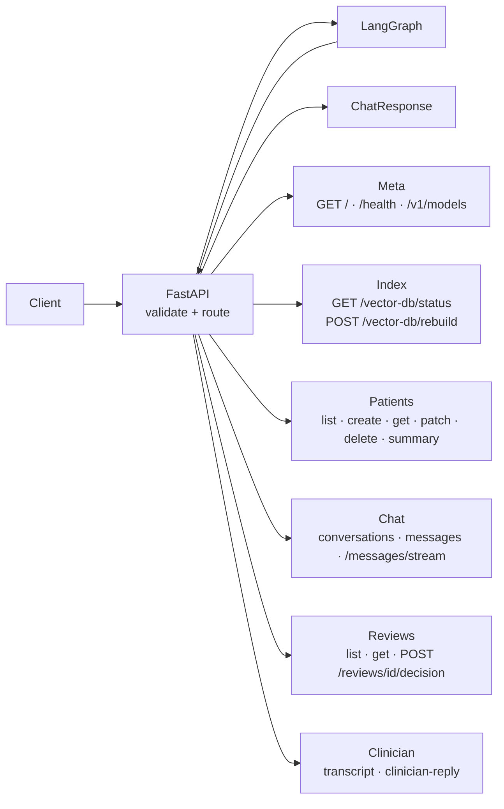
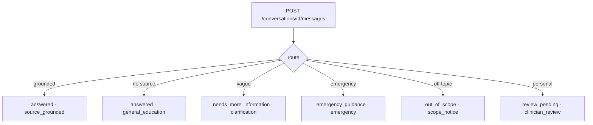

# API

Base URL: `http://127.0.0.1:8000`. Interactive docs: `/docs` (Swagger), `/redoc`.

## Endpoints by tag

- Tags: **Meta, Index, Patients, Chat, Reviews, Clinician**.
- `/v1/models` is an OpenAI-compatible shim for external probes; the UI never calls it.
- Details and request/response shapes: see `/docs`.

## Chat outcomes

- Stream endpoint emits `token` events then one terminal `response` event; guardrails and review are unchanged.
- `ChatResponse`: `answer`, `sources`, `tool_activity`, `status`, `answer_mode`, `thread_id`, `review_id`, `review_status`.
- `sources`: `{id, title, path, page, excerpt, relevance_score}` — repo-relative path, one-based page.
- Errors: `404` not found · `409` invalid decision · `503` LLM/index unavailable · `500` unexpected (traceback logged, never returned).
