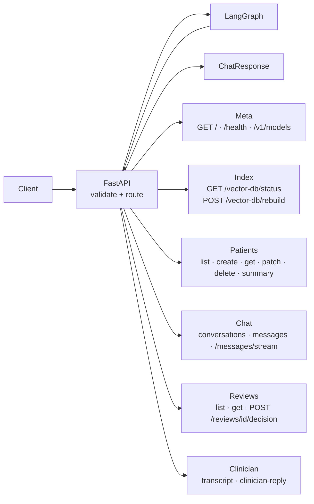
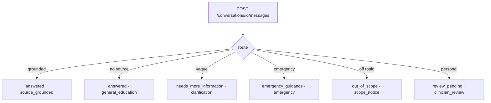

# API

Base URL: `http://127.0.0.1:8000`. Interactive docs: `/docs` (Swagger), `/redoc`.

## Endpoints by tag



- Tags: **Meta, Index, Patients, Chat, Reviews, Clinician**.
- `/v1/models` is an OpenAI-compatible shim for external probes; the UI never calls it.
- Details and request/response shapes: see `/docs`.

## Chat outcomes



- Stream endpoint emits `token` events then one terminal `response` event; guardrails and review are unchanged.
- `ChatResponse`: `answer`, `sources`, `tool_activity`, `status`, `answer_mode`, `thread_id`, `review_id`, `review_status`.
- `sources`: `{id, title, path, page, excerpt, relevance_score}` — repo-relative path, one-based page.
- Errors: `404` not found · `409` invalid decision · `503` LLM/index unavailable · `500` unexpected (traceback logged, never returned).
| `POST` | `/chat` | Ask a medical question (RAG) |

## `GET /health`

Returns `200` when the API is alive.

```json
{
  "status": "ok",
  "service": "DrugGPT",
  "version": "1.0"
}
```

Example:

```bash
curl http://127.0.0.1:8000/health
```

## `GET /`

```json
{ "status": "running" }
```

## `GET /v1/models`

OpenAI-compatible list containing the model from `LLM_MODEL`.

```json
{
  "object": "list",
  "data": [
    {
      "id": "llama-3.1-8b-instant",
      "object": "model",
      "created": 0,
      "owned_by": "groq"
    }
  ]
}
```

## `POST /chat`

Request body:

```json
{
  "message": "What is AIDS?",
  "thread_id": "demo-thread-1"
}
```

- `message`: the user's question.
- `thread_id`: keeps conversation state together. Reuse the same id for the
  same chat session.

Response: `200` with `text/plain` containing the answer.

```bash
curl -X POST http://127.0.0.1:8000/chat ^
  -H "Content-Type: application/json" ^
  -d "{\"message\":\"What is AIDS?\",\"thread_id\":\"demo-thread-1\"}"
```

PowerShell:

```powershell
Invoke-RestMethod -Method Post -Uri "http://127.0.0.1:8000/chat" `
  -ContentType "application/json" `
  -Body '{"message":"What is AIDS?","thread_id":"demo-thread-1"}'
```

## Notes

- The answer is generated by the LLM from Pinecone context, so the first
  request can be slower.
- `POST /chat` needs `GROQ_API_KEY` and `PINECONE_API_KEY` in `.env`.
- See [rag-pipeline.md](rag-pipeline.md) for how the answer is produced.