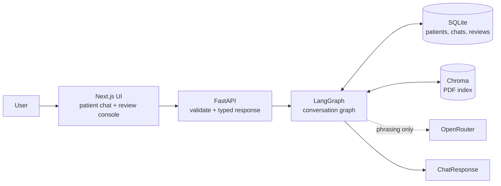
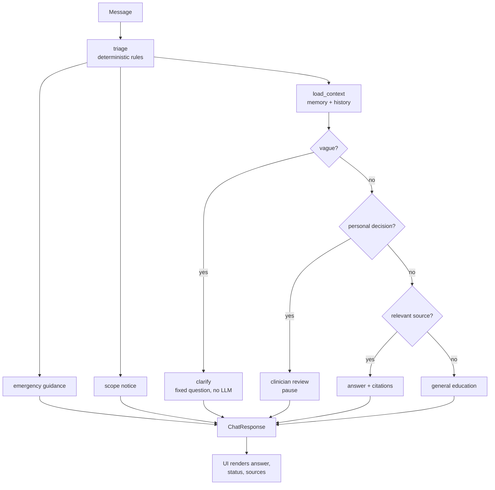
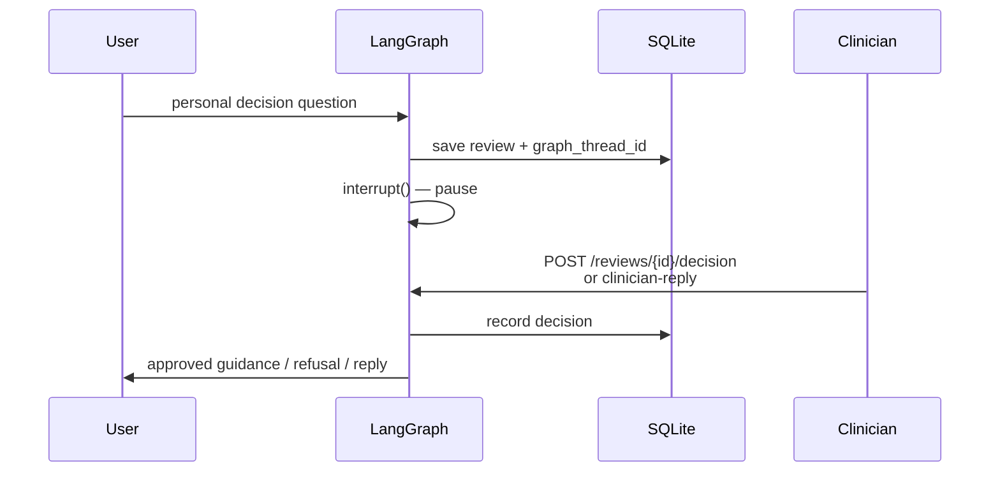

# Architecture

DrugGPT is a **local-first, source-grounded medical education app**. LangGraph owns the conversation; FastAPI owns the HTTP boundary. OpenRouter only phrases answers — it never decides what the app may do.

## System at a glance



- Two apps: FastAPI backend (:8000) and Next.js frontend in `Frontend/` (:3000).
- Data and the vector index stay on the local machine.
- `src/` is the package root (`src.*`).

## Message flow



- RAG runs **only** on the educational/symptom path.
- Clarifications, emergencies, scope notices, and personal decisions never retrieve.
- Emergency classification always wins.
- `POST .../messages/stream` adds SSE tokens; guardrails and review are unchanged.

## Triage routes

- `emergency` → immediate guidance · `out_of_scope` → scope notice
- `needs_more_information` → clarify (fixed, reviewed question)
- `general`, `symptom` → RAG answer or general education
- `medication_review`, `test_decision`, `treatment_decision`, `report_interpretation` → clinician review

## Clinician review gate



- Personal decisions pause before any guidance is shown.
- Reviews use a separate thread so a pause does not block later turns.
- Rejected reviews become a safety refusal; a free-text reply closes the review as approved.

See [`rag-and-data.md`](rag-and-data.md), [`safety-and-scope.md`](safety-and-scope.md), [`api.md`](api.md).
| Core | `backend/core/` | Settings and the shared embedding model |
| RAG | `backend/rag/` | Search Pinecone, ask the LLM, run the graph |
| Ingestion | `backend/ingestion/` | Load PDFs and upload chunks to Pinecone |

## Chat request flow

```
Streamlit UI  (frontend/streamlit_app.py)
        |
        |  POST /chat { message, thread_id }
        v
FastAPI route  (backend/api/routes/chat.py)
        |
        v
LangGraph workflow  (backend/rag/graph.py)
        |
        v
rag_tool  (backend/rag/generation.py)
        |
        +----------------------+
        |                      |
        v                      v
Pinecone search            Groq LLM
(backend/rag/retrieval.py)
```

## Ingestion flow

```
PDFs (Medical Books/)
   -> DirectoryLoader
   -> RecursiveCharacterTextSplitter
   -> HuggingFace embeddings
   -> Pinecone index
```

Run it with `python -m scripts.ingest`. See [setup.md](setup.md).

## Design rules

1. **One job per file.** API, retrieval, generation, and ingestion stay separate.
2. **No work at import time.** No network calls or model downloads on import.
3. **Settings come from `backend/core/config.py`.** No hardcoded keys, paths, or model names.
4. **Run commands from the project root.** That keeps `backend.*` imports working.

