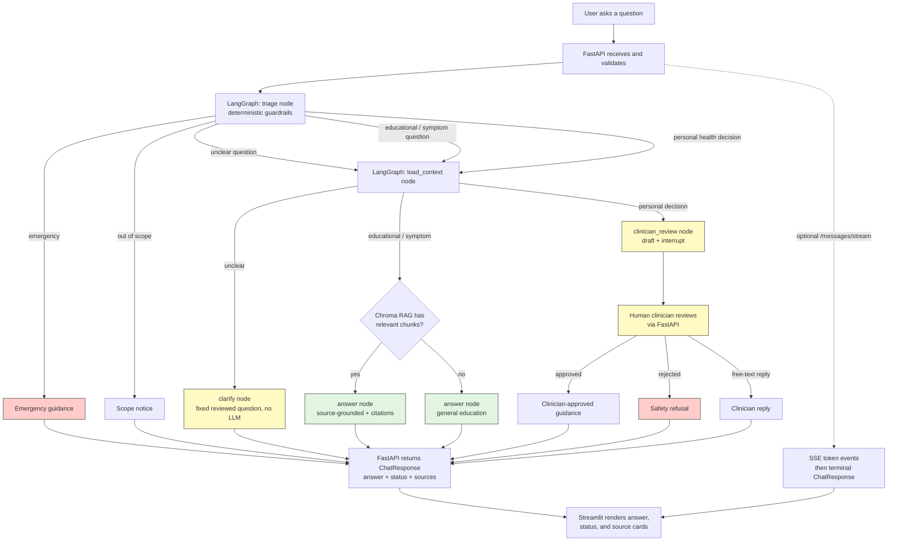

# Architecture

DrugGPT is a **local-first, source-grounded medical education application**. Everything runs on your machine: the FastAPI backend, the Streamlit frontend, the Chroma vector index, and the SQLite store. An external language model (via OpenRouter) is used only to phrase responses; it never decides what the app is allowed to do.

Two frameworks carry the whole system:

- **LangGraph** owns the conversation. Every message runs through a state graph that decides *how* to respond.
- **FastAPI** owns the HTTP boundary. It validates requests, starts the graph, and returns typed responses.

There is no separate hand-written orchestration layer — routing, RAG invocation, clarification, and human handoff all live in the LangGraph graph, and all external access goes through FastAPI.

## What the architecture looks like

The system has four parts:

1. **User interfaces** — Streamlit pages for patients, clinicians, and admins.
2. **FastAPI boundary** — typed routes, validation, and `ChatResponse` models.
3. **LangGraph conversation graph** — triage → context → one of six response paths.
4. **Local stores** — SQLite for conversation data and ChromaDB for the searchable PDF index.



**How to read the diagram:** red nodes are immediate safety outcomes, yellow nodes are "wait for a human or for more detail," and green nodes are educational answers. The important point is that **RAG is invoked only on the educational/symptom path**. Clarifications, emergencies, scope notices, and personal health decisions never trigger retrieval.

## How a message flows through the system

1. **Patient sends a message** — Streamlit posts to `POST /conversations/{id}/messages`.
2. **FastAPI validates and loads** — the route checks the request, loads the conversation from SQLite, and calls `MedicalRAGService.send_message`.
3. **LangGraph runs `triage`** — deterministic regex rules classify the message as emergency, out-of-scope, needs-more-information, general, symptom, or one of four personal-decision types.
4. **Human mode short-circuits the graph** — if `Conversation.mode == "human"`, the message is queued with `answer_mode="human_hold"` and no graph/LLM call happens.
5. **`load_context` adds memory** — approved patient facts, the latest summary, and the last eight messages are added to the graph state.
6. **The graph picks one response path**:
   - **Emergency / out-of-scope** → immediate fixed guidance.
   - **Unclear** → the `clarify` node returns a fixed, reviewed follow-up question with no LLM call (opt in with `DRUGGPT_LLM_CLARIFY=1` for a prompt-generated one); no retrieval, no medical advice.
   - **General / symptom** → the `answer` node searches Chroma in cosine space. Chunks whose clamped cosine similarity is at or above `DRUGGPT_RELEVANCE_THRESHOLD` produce a source-grounded answer with citations; otherwise the same node produces a general-education answer using a system prompt and conversation history. `POST /conversations/{id}/messages/stream` streams this answer as SSE tokens before returning the same stored `ChatResponse`.
   - **Personal health decision** → the `clinician_review` node drafts internal guidance, saves a review row, and pauses with `interrupt()`.
7. **A clinician resolves the hold** — through `POST /reviews/{id}/decision` (approve/reject) or `POST /conversations/{id}/clinician-reply` (free text). The graph thread is resumed with `Command(resume=...)`, keyed by the stored `graph_thread_id`.
8. **FastAPI returns one `ChatResponse`** — answer, status, `answer_mode`, sources, and tool activity. Streamlit renders the right caption for each mode.

## Triage categories

| Category | Meaning | Graph path |
|----------|---------|------------|
| `emergency` | Chest pain, trouble breathing, overdose, self-harm, etc. | Immediate emergency guidance |
| `out_of_scope` | Non-medical requests (code, weather, sports, etc.) | Scope notice |
| `needs_more_information` | Very short or generic message ("help", "hi there") | `clarify` node |
| `general` | Medical science / drug-study education | RAG → `answer` |
| `symptom` | Symptom-related education | RAG → `answer` |
| `medication_review` | "What medicine/dose should I take?" | `clinician_review` |
| `test_decision` | "What test/scan should I get?" | `clinician_review` |
| `treatment_decision` | "What treatment should I start?" | `clinician_review` |
| `report_interpretation` | "What does my test report mean?" | `clinician_review` |

Emergency classification always wins over the other rules.

## Project layout

The project uses a flat `src` layout (the package root is `src`, imported as `src.*`):

```text
DrugGPT/
├── main.py                     # lazy app export for `uvicorn main:app`
├── .env                        # runtime secrets (untracked)
├── .env.example                # template for .env
├── pyproject.toml
├── src/
│   ├── __init__.py
│   ├── cli.py                  # CLI commands (testable, no server start)
│   ├── api/app.py              # FastAPI application
│   ├── core/
│   │   ├── config.py           # Settings (env/.env, validation, directories)
│   │   ├── runtime.py          # no-TensorFlow shims (import first in entrypoints)
│   │   ├── models.py           # typed request/response/domain models
│   │   └── persistence.py      # SQLite store (patients, conversations, reviews)
│   ├── rag/
│   │   ├── guardrails.py       # triage rules + clinician-review categories
│   │   ├── indexing.py         # Chroma index rebuild from data/raw
│   │   ├── retrieval.py        # Chroma retrieval + provenance
│   │   └── service.py          # LangGraph state graph + prompts
│   └── ui/
│       ├── Patient_Chat.py     # patient chat page
│       ├── api_client.py       # testable HTTP client
│       └── pages/              # Streamlit multipage UI
│           ├── 1_Patient_Profile.py
│           ├── 2_Clinician_Chat.py
│           └── 3_Admin.py
├── tests/
└── data/                       # raw PDFs, Chroma index, checkpoints, druggpt.db (ignored by Git)
```

## Components

| Module | Responsibility |
|--------|----------------|
| `src.api` | FastAPI backend and HTTP boundary |
| `src.core` | Settings and typed shared API/domain models |
| `src.rag.guardrails` | Deterministic triage and the set of categories that require human review |
| `src.rag.service` | LangGraph nodes, edges, prompts, and response mapping |
| `src.rag.indexing` / `src.rag.retrieval` | PDF chunking and Chroma-backed evidence |
| `src.ui` | Streamlit application and testable HTTP client |
| `src.core.runtime` | TensorFlow-disable shims and warning filters applied before heavy imports |
| `src.cli` | Maintenance commands (`index`, `check`, `test`) |

## Two kinds of human-in-the-loop behavior

| Mechanism | Trigger | Endpoint | Purpose |
|-----------|---------|----------|---------|
| **Clinician review gate** | Triage is medication, test, treatment, or report interpretation | `POST /reviews/{id}/decision` | Approve or reject AI-drafted guidance before the patient sees it |
| **Human clinician chat mode** | `Conversation.mode == "human"` | `POST /conversations/{id}/clinician-reply` | Queue patient messages so a clinician writes a free-text reply; any pending review is closed as approved and mode returns to `"ai"` |

Both paths store the result in SQLite and resume the same `graph_thread_id` saved before the interrupt. Emergency messages are never routed through either path.

## Persistence

`data/raw` holds local licensed PDFs; `data/chroma` holds the disposable Chroma index; `data/checkpoints` holds LangGraph conversation checkpoints; `data/druggpt.db` is the SQLite store for patients, conversations, and reviews. None are committed to Git.

## Running the project

See [`setup.md`](setup.md) for full installation instructions. The short version is:

```bash
# 1. Create environment and install
python -m venv .venv
.venv\Scripts\activate        # Windows
# source .venv/bin/activate   # macOS/Linux
pip install -e '.[dev]'

# 2. Configure
cp .env.example .env
# edit .env and set OPENROUTER_API_KEY
mkdir -p data/raw
# copy licensed medical PDFs into data/raw/

# 3. Terminal 1: FastAPI backend (:8000) with auto-reload
uvicorn main:app --reload --host 127.0.0.1 --port 8000

# 4. Terminal 2: Streamlit frontend (:8501)
streamlit run src/ui/Patient_Chat.py --server.port 8501
```

Or use the maintenance CLI:

```bash
python -m src.cli index # rebuild Chroma index from data/raw
python -m src.cli check # print resolved config + API health
python -m src.cli test  # run the pytest suite
```

`uvicorn main:app` resolves the lazy ``app`` exported by ``main.py``; logging is configured at import time so request logs appear immediately in that terminal.

The API is available at `http://127.0.0.1:8000` (Swagger UI at `/docs`, ReDoc at `/redoc`); the UI at `:8501`. Use the Streamlit sidebar **Rebuild local medical source index** after adding PDFs.

## Safety and scope

DrugGPT is an educational assistant, not a clinician. It explains medical topics conversationally, asks for clarification when a question is vague, and cites local sources when they support an answer. It **does not** diagnose, prescribe, choose a test, recommend a treatment, or interpret a personal test report — those requests are paused for a human clinician. When no indexed source sufficiently supports a question, it gives general educational information rather than inventing an answer. Emergencies get immediate guidance, never a review queue. See [`safety-and-scope.md`](safety-and-scope.md).

## Related docs

- [`setup.md`](setup.md) — installation, configuration, and startup commands
- [`api.md`](api.md) — endpoint reference and response schemas
- [`rag-and-data.md`](rag-and-data.md) — indexing workflow, retrieval, and citation rules
- [`safety-and-scope.md`](safety-and-scope.md) — guardrails, scope, and verification policy
- [`adr/0001-local-chroma-source-grounded-rag.md`](adr/0001-local-chroma-source-grounded-rag.md) — original ADR for local ChromaDB
