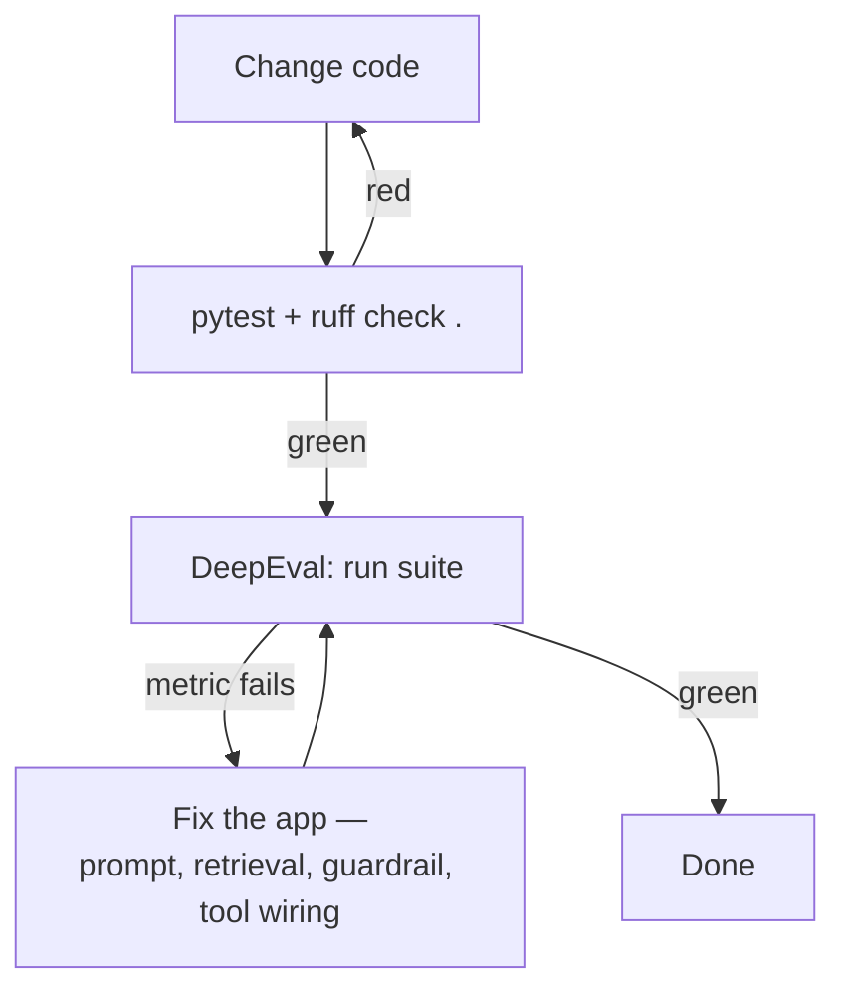

# Development



- Tests are offline: fake retrievers, in-memory store, LLM stub — no key, network, or PDFs needed.
- Add behavioral tests for guardrails, response schemas, indexing, retrieval scoring, and UI client calls.
- Never commit `.env` or anything under `data/`.
- Imports use `src.*`; call `src.core.runtime.configure_runtime()` first in any new entrypoint.
- Logs read "what happened + ids + outcome" in plain language.

## DeepEval loop

```bash
$env:PYTHONIOENCODING = "utf-8"
$env:DEEPEVAL_PER_ATTEMPT_TIMEOUT_SECONDS_OVERRIDE = "900"
deepeval test run tests/evals/test_druggpt.py
```

- Goldens: `tests/evals/goldens.json`; generated goldens go to gitignored `data/evals/` first.
- Judge uses `OPENROUTER_API_KEY`; `OPENROUTER_FALLBACK_API_KEY` is a fallback only. Never overwrite the primary key.
- Fix the app, never the metric, threshold, or golden — then re-run.
- Internals: caches require `invalidate_caches()` after rebuild; scores are `clamp(1 - cosine_distance, 0, 1)`; `/v1/models` is a probe shim.

More project context: [`AGENTS.md`](AGENTS.md) · [`SKILLS.md`](SKILLS.md).
