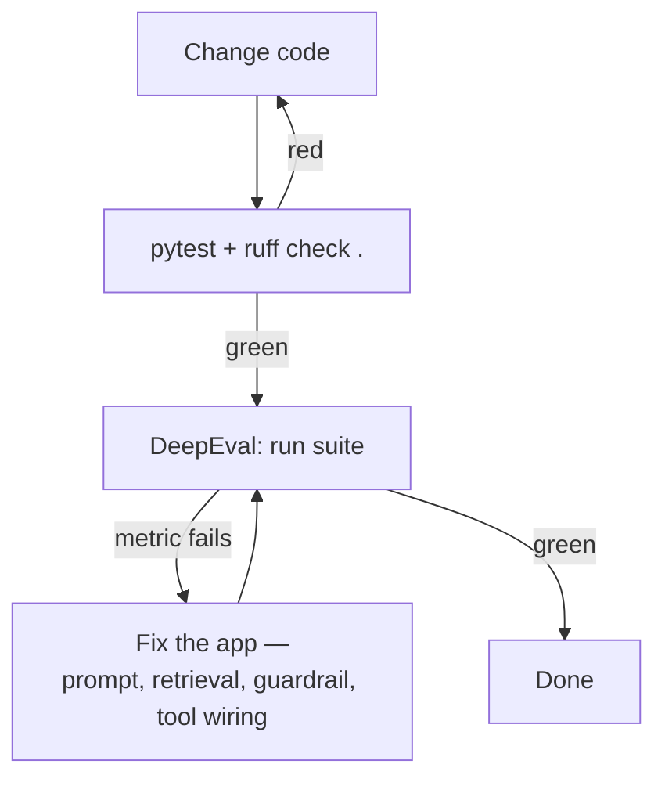

# Development



- Tests are offline: fake retrievers, in-memory store, LLM stub — no key, network, or PDFs needed.
- Add behavioral tests for guardrails, response schemas, indexing, retrieval scoring, and UI client calls.
- Never commit `.env` or anything under `data/`.
- Imports use `src.*`; call `src.core.runtime.configure_runtime()` first in any new entrypoint.
- Logs read "what happened + ids + outcome" in plain language.

## DeepEval loop

```bash
$env:PYTHONIOENCODING = "utf-8"
$env:DEEPEVAL_PER_ATTEMPT_TIMEOUT_SECONDS_OVERRIDE = "900"
deepeval test run tests/evals/test_druggpt.py
```

- Goldens: `tests/evals/goldens.json`; generated goldens go to gitignored `data/evals/` first.
- Judge uses `OPENROUTER_API_KEY`; `OPENROUTER_FALLBACK_API_KEY` is a fallback only. Never overwrite the primary key.
- Fix the app, never the metric, threshold, or golden — then re-run.
- Internals: caches require `invalidate_caches()` after rebuild; scores are `clamp(1 - cosine_distance, 0, 1)`; `/v1/models` is a probe shim.

More project context: [`AGENTS.md`](AGENTS.md) · [`SKILLS.md`](SKILLS.md).
1. **One job per file.** Do not mix API, retrieval, and generation.
2. **No work at import time.** Do not connect to Pinecone or download models
   when a file is imported.
3. **Settings go in `backend/core/config.py`.**
4. **Use full import paths:** `from backend.rag.retrieval import ...`.
5. **Run from the project root.**

## Add a new API route

1. Create a file in `backend/api/routes/`, for example `stats.py`.
2. Define a router:

```python
from fastapi import APIRouter

router = APIRouter(tags=["stats"])


@router.get("/stats")
def stats():
    return {"documents": 0}
```

3. Include it in `backend/main.py`:

```python
from backend.api.routes.stats import router as stats_router

app.include_router(stats_router)
```

4. Add request/response models to `backend/api/schemas.py` if needed.

## Add a graph step

1. Write a node in `backend/rag/graph.py` (or a new module in `backend/rag/`).
2. Register it with `builder.add_node(...)`.
3. Connect it with `builder.add_edge(...)`.
4. Update `MedicalState` in `backend/rag/state.py` if it needs new fields.

## Add a setting

1. Add it to `backend/core/config.py`:

```python
MY_SETTING = os.getenv("MY_SETTING", "default")
```

2. Add it to `.env.example`.
3. Import it where needed. Never call `os.getenv()` elsewhere.

## Folder conventions

| Folder | Add here |
| --- | --- |
| `backend/api/` | Routes and schemas |
| `backend/core/` | Config and shared clients |
| `backend/rag/` | Retrieval, generation, graph |
| `backend/ingestion/` | Offline indexing |
| `scripts/` | One-off commands |
| `test/` | Manual checks |
| `docs/` | Documentation |

## Before you commit

```bash
python -m compileall backend scripts frontend test
python -m scripts.smoke_test_llm
python -m test.vector_db_test
```

See [testing.md](testing.md) for details.
