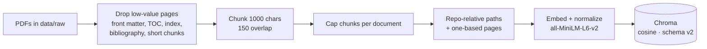
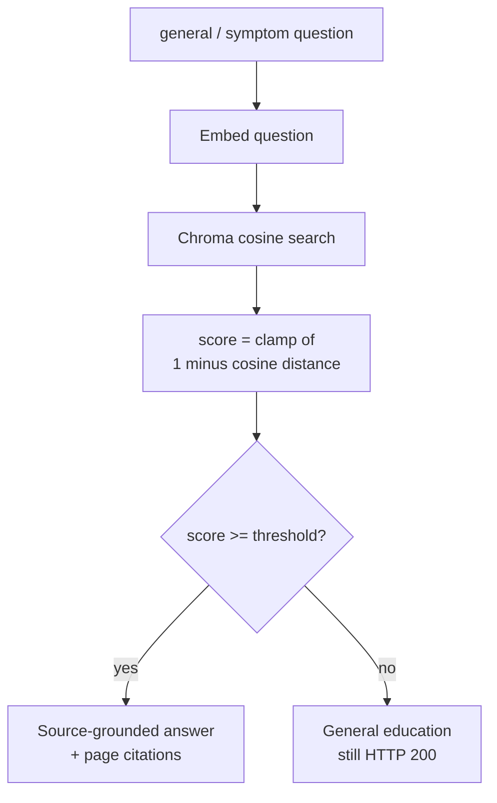

# RAG and data

Only index PDFs you are licensed to process. Keep them in `data/raw` (untracked).

## Indexing

`POST /vector-db/rebuild` builds the local Chroma collection:

- The index is disposable; keep the original PDFs and rebuild anytime.
- One large book cannot dominate results (per-document cap).
- Old L2 indexes report `needs_rebuild=true`; answers then have no citations until rebuilt.

## Retrieval

- RAG runs **only** for `general` / `symptom` questions.
- Score = `clamp(1 - cosine_distance, 0, 1)`; default threshold `0.35`.
- No index or low score is **not** an error — only LLM/config failures return 503.
- Cached embedder/client/store are cleared after a rebuild (`invalidate_caches()`).
- Streaming sends token events, then the same stored `ChatResponse`.

## Data directories

- `data/raw/` — licensed PDFs · `data/chroma/` — index
- `data/checkpoints/` — chat state (one thread per conversation; reviews use a separate thread)
- `data/druggpt.db` — patients, conversations, reviews
