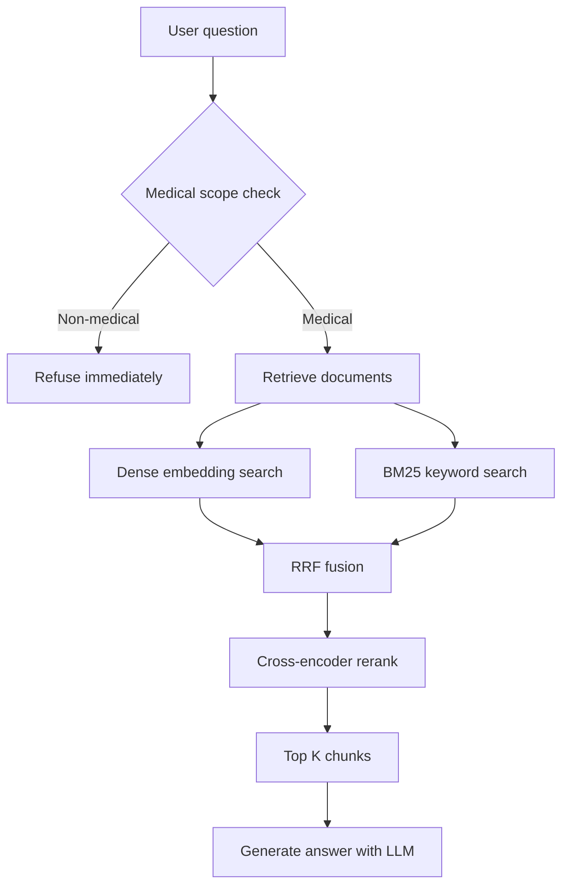

# RAG Pipeline

RAG means **Retrieval-Augmented Generation**: we look up real text first,
then ask the LLM to answer using that text.

> For the full build guide with diagrams, see
> [vector-db-guide.md](vector-db-guide.md).

## Step 1: Ingestion (offline)

Files: `backend/ingestion/vector_db.py`, run by `scripts/ingest.py`

```text
PDFs in Medical Books/
   -> load_pdf_documents()          # PyMuPDF, page by page
   -> normalize_text()              # clean PDF characters
   -> split_documents()             # 1,200 chars, 200 overlap
   -> build_records()               # IDs, title, source, page, domain
   -> Pinecone documents.upsert()   # server-side NVIDIA embedding
```

No local embedding model is loaded. Pinecone embeds `chunk_text` with
`llama-text-embed-v2` (1024 dimensions, cosine) when the document is written.

Settings come from `backend/core/config.py` (`CHUNK_SIZE`, `CHUNK_OVERLAP`,
`MEDICAL_BOOKS_DIR`, `PINECONE_INDEX_NAME`, `PINECONE_NAMESPACE`).

## Step 2: Medical scope check

File: `backend/rag/scope.py`

Before retrieval, a tiny Groq call classifies the question as `MEDICAL` or
`OTHER`. Clearly non-medical requests are refused immediately, so they never
reach Pinecone or the answer model. If the classifier call fails, the question
is allowed through (fail open) and the main prompt still enforces the rules.

## Step 3: Retrieval

File: `backend/rag/retrieval.py`

```text
question
  -> dense search      (score_by: embed, chunk_text)
  -> keyword search    (score_by: text, chunk_text + title)
  -> RRF fusion        (combine both rankings)
  -> rerank            (bge-reranker-v2-m3)
  -> top 5 chunks      (book title + page)
```

Pinecone stores the text and its embedding, so the app only sends query text.
Both searches filter on `domain = "medical"`.

`retrieve_context(query, k=5)` returns the chunks joined into one string.
Each chunk starts with a header such as:

```text
[Source: Current Essentials of Medicine, page 33]
```

### Namespace configuration

The Pinecone namespace tells the server which set of documents to search.
This is set via the `PINECONE_NAMESPACE` environment variable (default: `medical-books`).

- **Correct**: `PINECONE_NAMESPACE=medical-books` in `.env`
- **Incorrect**: `PINECONE_NAMESPACE=` (empty) — this causes Pinecone to
  reject the search with `ValidationError: namespace must be a non-empty string`

The `.env.example` already has the correct value `PINECONE_NAMESPACE=medical-books`.
If you copy `.env.example` to `.env`, this is set automatically.



> **Note:** If retrieval fails with "namespace must be a non-empty string",
> check that `PINECONE_NAMESPACE` in your `.env` is set (e.g. to
> `medical-books`) and not left empty.
```

## Step 4: Generation

File: `backend/rag/generation.py`

```python
answer = (PROMPT | llm).invoke({
    "context": context,
    "history": history,
    "question": question,
})
```

The prompt:

- Only answers medical and health questions.
- Says "I could not find this in the medical references" when no chunk matches.
- Forbids inventing doses, drug names, facts, or guideline numbers.
- Asks for a book title and page citation.
- Adds a safety note for urgent symptoms, dosing, pregnancy, or children.

If retrieval returns no chunks, the app returns the "not found" message without
calling the LLM.

## Step 5: Graph

File: `backend/rag/graph.py`

```text
START -> medical_rag -> END
```

- `rag_node(state)` reads `state["question"]` and the persisted `messages`,
  calls `rag_tool`, then writes `context`, `answer`, and the new `AIMessage`
  back into the state.
- `messages` uses LangGraph's `add_messages` reducer, so every turn is
  appended instead of replacing the conversation.
- The graph is compiled at application startup with `AsyncSqliteSaver`, so
  state is kept per `thread_id` in `data/checkpoints.sqlite` and survives a
  server restart.
- `create_graph(checkpointer=...)` takes the checkpointer as an argument.
  There is no module-level graph and no import-time database work.

## Persistence and history

The checkpointer is **short-term memory**. It stores each thread's full
state, including every message. `GET /threads/{thread_id}` reads that state
with `graph.aget_state(...)` and returns the messages to the UI.

Long-term memory will use `AsyncSqliteStore` later. It is a separate concern
from the per-thread checkpoint.

## Where to tune things

| Want to change | File |
| --- | --- |
| Chunk size or overlap | `.env` / `backend/core/config.py` |
| Embedding model | The Pinecone index schema (fixed) |
| LLM model or temperature | `.env` / `backend/core/config.py` |
| Prompt text | `backend/rag/generation.py` |
| Medical scope rules | `backend/rag/scope.py` |
| How many chunks are retrieved | `RETRIEVAL_TOP_K` in `.env` |
| Hybrid vs dense search | `RETRIEVAL_MODE` in `.env` |
| Reranking | `RETRIEVAL_RERANK` and `RERANK_MODEL` in `.env` |
| Graph steps | `backend/rag/graph.py` |
| History window | `MEMORY_WINDOW_MESSAGES` in `.env` |
| SQLite locations | `backend/core/config.py` |
