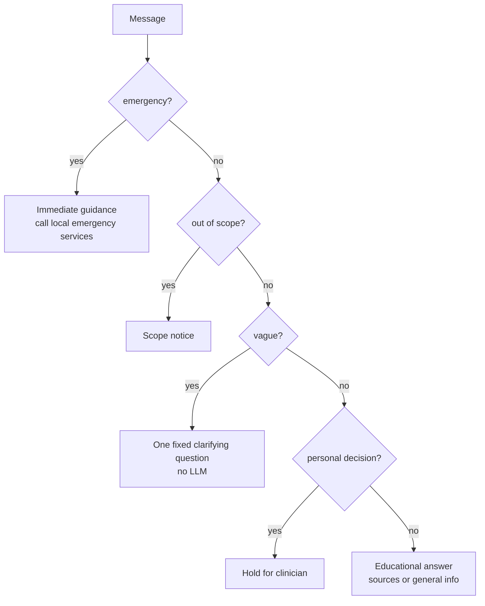

# Safety and scope

DrugGPT is a **medical education assistant**, not a clinician.

## What happens to a message

- Emergency signals (chest pain, breathing trouble, overdose, self-harm) are checked first and always win.
- Emergencies never enter a review queue.
- Vague messages get a reviewed, fixed question — no guessing.

## In and out of scope

- **Does:** explain medical topics, cite local PDFs, label general information, ask for clarification, hold personal decisions.
- **Does not:** diagnose, prescribe, choose a test or treatment, interpret a personal report, give individual doses, or replace a professional.

## Clinician hold

- Triggers: **medicine**, **testing**, **treatment**, **test report**.
- The AI draft stays internal until a clinician approves, rejects, or writes a free-text reply.
- Rejected reviews become a safety refusal.

## Local only

- No authentication. Bound to `127.0.0.1` unless `DRUGGPT_ALLOW_REMOTE=1` (trusted local demos only).
- Never enter real patient data or expose the service publicly.
- Verify conclusions against the original PDFs; citations use repo-relative paths and one-based pages.
