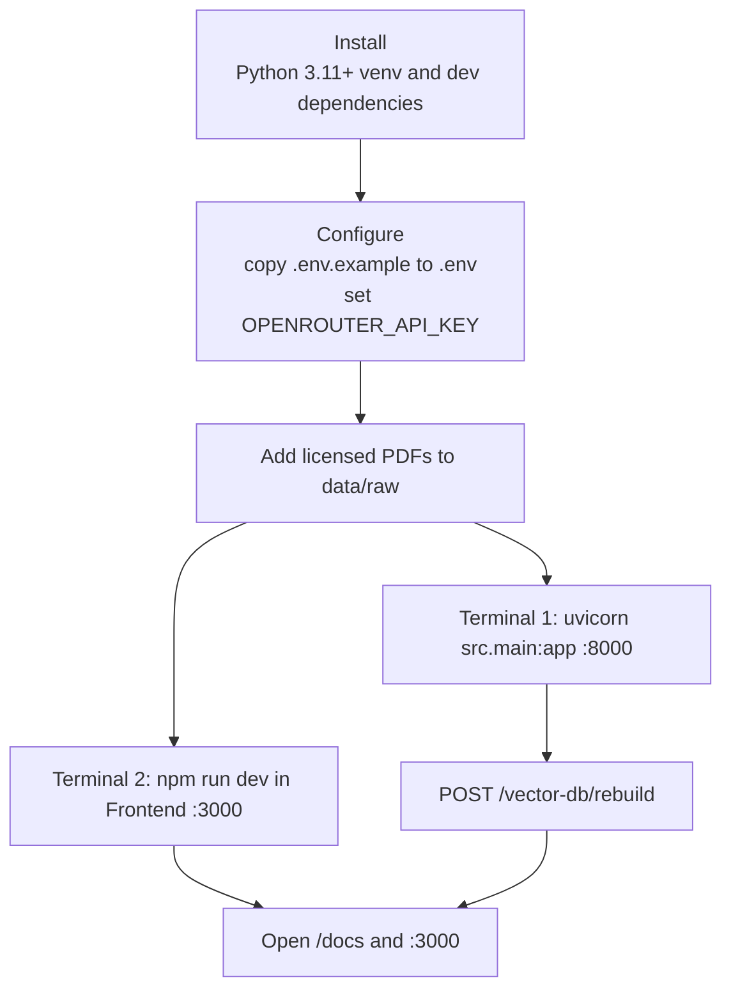

# Setup



- Python 3.11+, an OpenRouter key, and licensed PDFs are required.
- Frontend uses mock data until `NEXT_PUBLIC_API_BASE_URL` is set in `Frontend/.env.local`.
- TensorFlow is disabled at startup by `src/core/runtime.py` — no action needed.
- After upgrading, rebuild the index once; old L2 indexes have no citations.
- API is loopback-only by default (`DRUGGPT_ALLOW_REMOTE=0`); `LocalStore` has no auth.

## Commands

```bash
python -m venv .venv
.\.venv\Scripts\Activate.ps1
pip install -e '.[dev]'
cp .env.example .env
uvicorn src.main:app --reload --host 127.0.0.1 --port 8000
# second terminal
cd Frontend && npm install && npm run dev
```

- Full settings: `.env.example` · URLs: `/docs` · frontend details: `Frontend/README.md`.
- Verify: `pytest` and `ruff check .`.
