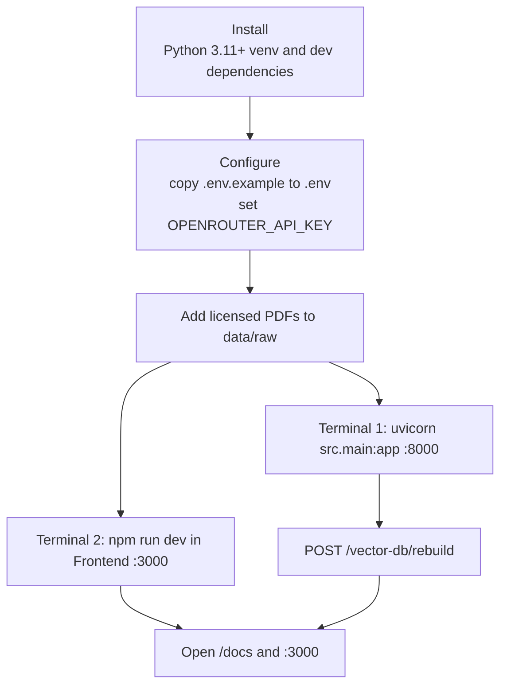

# Setup



- Python 3.11+, an OpenRouter key, and licensed PDFs are required.
- Frontend uses mock data until `NEXT_PUBLIC_API_BASE_URL` is set in `Frontend/.env.local`.
- TensorFlow is disabled at startup by `src/core/runtime.py` — no action needed.
- After upgrading, rebuild the index once; old L2 indexes have no citations.
- API is loopback-only by default (`DRUGGPT_ALLOW_REMOTE=0`); `LocalStore` has no auth.

## Commands

```bash
python -m venv .venv
.\.venv\Scripts\Activate.ps1
pip install -e '.[dev]'
cp .env.example .env
uvicorn src.main:app --reload --host 127.0.0.1 --port 8000
# second terminal
cd Frontend && npm install && npm run dev
```

- Full settings: `.env.example` · URLs: `/docs` · frontend details: `Frontend/README.md`.
- Verify: `pytest` and `ruff check .`.
- A Pinecone API key and index

## 1. Create the environment

```bash
conda create -n ai python=3.11
conda activate ai
```

## 2. Install dependencies

```bash
pip install -r requirements.txt
```

## 3. Create `.env`

```bash
cp .env.example .env
```

Fill in the values:

| Variable | Meaning |
| --- | --- |
| `GROQ_API_KEY` | Groq API key for the LLM |
| `LLM_MODEL` | Groq model name |
| `LLM_TEMPERATURE` | 0 = focused, 1 = creative |
| `PINECONE_API_KEY` | Pinecone API key |
| `PINECONE_INDEX_NAME` | Index name (default `medical-rag`) |
| `EMBEDDING_MODEL_NAME` | HuggingFace embedding model |
| `MEDICAL_BOOKS_DIR` | Folder containing the PDFs |
| `CHUNK_SIZE`, `CHUNK_OVERLAP` | Text split settings |

## 4. Add the PDFs

Put the medical book PDFs in:

```
Medical Books/
```

## 5. Index the books (first time only)

```bash
python -m scripts.ingest
```

## 6. Run the backend

```bash
uvicorn backend.main:app --reload
```

Open:

- API root: `http://127.0.0.1:8000/`
- Health check: `http://127.0.0.1:8000/health`
- Interactive docs: `http://127.0.0.1:8000/docs`

## 7. Run the frontend

In a second terminal:

```bash
streamlit run frontend/streamlit_app.py
```

## Quick sanity checks

```bash
# LLM connection
python -m scripts.smoke_test_llm

# Pinecone retrieval
python -m test.vector_db_test
```

## Troubleshooting

| Problem | Fix |
| --- | --- |
| `/health` returns 404 | Restart the server so it loads the latest code |
| `ModuleNotFoundError: fastapi` | Wrong Python. Activate `ai` first |
| `PINECONE_API_KEY` missing | Add it to `.env` and restart |
| Slow first request | The embedding model is loading for the first time |
