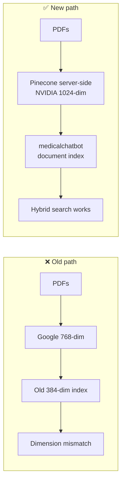
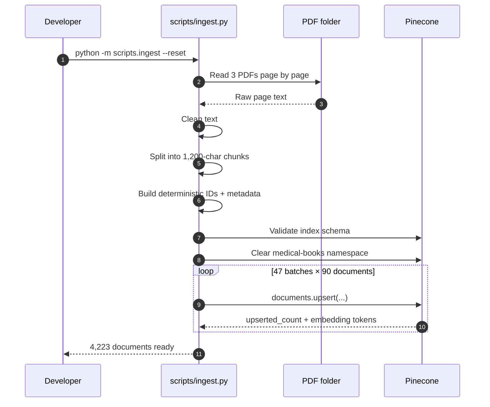
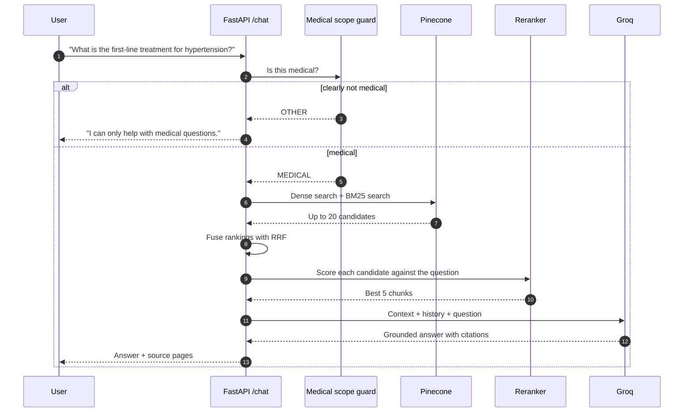
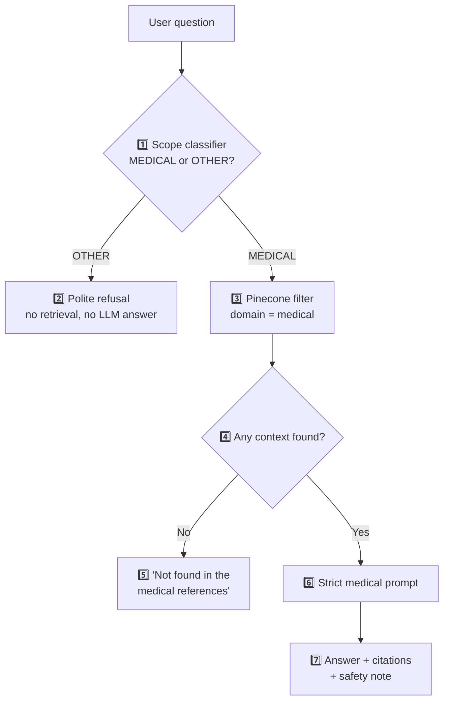

# 🏗️ DrugGPT Medical Vector Database — Build Guide

> **Who this is for:** anyone who wants to understand, rebuild, or tune the
> medical search database behind DrugGPT.
>
> **Goal:** turn three medical PDFs into a fast, accurate, **medical-only**
> knowledge base that the chatbot can search in under a second.

---

## 1. At a glance

```text
┌──────────────────────────────────────────────────────────────────┐
│  INDEX NAME      medicalchatbot                                  │
│  INDEX TYPE      Pinecone document index                         │
│  HOST            medicalchatbot-p5shb1b.svc.aped-4627-b74a...    │
│  EMBEDDING       NVIDIA llama-text-embed-v2 · 1024 dim · cosine  │
│  KEYWORD SEARCH  BM25 · English · chunk_text + title             │
│  NAMESPACE       medical-books                                   │
│  SOURCE BOOKS    3 PDFs from "Medical Books"                     │
│  DOCUMENTS       4,223 chunks                                    │
│  BUILD TIME      ~4 minutes                                      │
└──────────────────────────────────────────────────────────────────┘
```

| Question | Short answer |
| --- | --- |
| Do we create embeddings on our laptop? | **No.** Pinecone does it on the server. |
| Do we use Google embeddings? | **No.** The index uses NVIDIA `llama-text-embed-v2`. |
| Do we need a local GPU? | **No.** |
| How does the chatbot stay medical-only? | Scope check + medical filter + strict prompt. |
| What happens if the answer is not in the books? | The bot says it could not find it. It does not guess. |

---

## 2. The big picture

```mermaid
flowchart LR
    A["📚 3 medical PDFs"] --> B["🔎 PyMuPDF<br/>extract text"]
    B --> C["🧹 Clean text<br/>remove junk characters"]
    C --> D["✂️ Chunk<br/>1,200 chars · 200 overlap"]
    D --> E["☁️ Pinecone Documents API"]
    E --> F[("🗄️ Index: medicalchatbot<br/>Namespace: medical-books")]
    F --> G["🔍 Hybrid search<br/>dense + BM25"]
    G --> H["🔗 RRF fusion"]
    H --> I["🎯 Rerank<br/>bge-reranker-v2-m3"]
    I --> J["📄 Top 5 chunks<br/>book title + page"]
    J --> K["🤖 Groq LLM"]
    K --> L["✅ Medical answer<br/>with citations"]
```



**Simple analogy:** the PDFs are books, the chunks are index cards, Pinecone is
the librarian, the reranker is a careful editor, and Groq is the writer who
turns the best cards into a clear answer.

---

## 3. The index schema

The schema is fixed when the index is created. We do **not** change it in code.

| Field | Type | Configuration | Why it matters |
| --- | --- | --- | --- |
| `chunk_text` | String | Dense embedding: **NVIDIA llama-text-embed-v2**, 1024 dimensions, cosine | Finds text with the same **meaning** as the question |
| `chunk_text` | String | Full-text search: **English (BM25)** | Finds exact words, drug names, and codes |
| `title` | String | Full-text search: **English (BM25)** | Helps when the question mentions a book or guideline name |

### Extra metadata on every document

These are stored with each chunk and returned with search results:

| Field | Example | Purpose |
| --- | --- | --- |
| `_id` | `current-essentials-of-medicine-p33-a1b2c3d4` | Unique, deterministic ID |
| `source` | `Current Essentials of Medicine(1)(1).pdf` | Original file |
| `page` | `33` | Page number for citations |
| `chunk_index` | `4` | Position inside the book |
| `domain` | `medical` | Hard filter so only medical content is searchable |

### One document looks like this

```json
{
  "_id": "current-essentials-of-medicine-p33-a1b2c3d4",
  "chunk_text": "Many recommend diuretics, beta-blockers, ACE inhibitors...",
  "title": "Current Essentials of Medicine",
  "source": "Current Essentials of Medicine(1)(1).pdf",
  "page": 33,
  "chunk_index": 12,
  "domain": "medical"
}
```

> **Important:** we never send a vector. We send plain text, and Pinecone
> creates the 1024-dimensional embedding for us.

---

## 4. Why the old RAG was failing

| Before | Problem | Now |
| --- | --- | --- |
| Google `gemini-embedding-001` (768 dim) | Did not match the old 384-dim index | NVIDIA `llama-text-embed-v2` (1024 dim) |
| `PineconeVectorStore` | Uses the old Vectors API | Pinecone **Documents API** |
| `medical-rag` index | 384-dim, old embeddings, 32,949 old vectors | New `medicalchatbot` index with the correct schema |
| Missing `PINECONE_INDEX_NAME` | Code pointed at a non-existent index | Name and host are set in `.env` |
| `langchain-pinecone` | Requires `pinecone<8`; Documents API needs `pinecone>=10.1` | Removed; direct Pinecone SDK |



---

## 5. Build the database

Run every command from the project root (`DrugGPT/`) using the `ai` environment.

### Step 1 — Activate the environment

```powershell
conda activate ai
```

### Step 2 — Check the index schema (no writing)

```powershell
python -c "from backend.core.pinecone_client import validate_index; validate_index(verbose=True)"
```

Expected: a message that the index is ready with 1024-dim embeddings and
full-text search.

### Step 3 — Dry run (parse only, no upload)

```powershell
python -m scripts.ingest --dry-run
```

Expected summary:

```text
Prepared 4238 chunks -> 4223 documents (skipped 15 empty/duplicate chunks).
  40mbs_medicalbooksstore_2017_essentials.pdf              2060 chunks
  Current Essentials of Medicine(1)(1).pdf                 1158 chunks
  standard-treatment-guidelines.pdf                        1005 chunks
```

### Step 4 — Full build

```powershell
python -m scripts.ingest --reset
```

`--reset` clears only the `medical-books` namespace, not the whole index.
Re-running is safe because every document has a deterministic `_id`.

### Step 5 — Verify

```powershell
python -m test.vector_db_test
```

This checks:

1. The live index schema.
2. The document count.
3. Three medical questions.
4. Two medical and two non-medical scope questions.

---

## 6. What happens during ingestion



### Build numbers

| Metric | Value |
| --- | --- |
| PDFs | 3 |
| Pages read | 1,676 |
| Extracted characters | ~3.7 million |
| Chunks created | 4,238 |
| Documents uploaded | **4,223** |
| Chunks skipped | 15 (empty or duplicate) |
| Embedding tokens | **1,634,496** |
| Batches | 47 |
| Time | ~4 minutes |

> Pinecone's current plan allows **250,000 embedding tokens per minute**. The
> script automatically retries with backoff when it sees a `429` rate limit.

---

## 7. How a question becomes an answer



### Why three retrieval steps?

| Step | What it is good at | Example |
| --- | --- | --- |
| Dense search | Meaning and paraphrases | "high blood pressure" finds "hypertension" |
| BM25 search | Exact words and names | "metformin", "CURB-65", "dengue" |
| Reranker | Careful final comparison | Picks the chunk that truly answers the question |

RRF means **Reciprocal Rank Fusion**. It combines two rankings by position, so
a score from the dense search and a score from BM25 do not need to be on the
same scale.

---

## 8. Medical-only guardrails



| Layer | What it does | Example |
| --- | --- | --- |
| 1. Scope classifier | One-word Groq call: `MEDICAL` or `OTHER` | Blocks "Write Python code" |
| 2. Refusal message | Clear, friendly, medical-only reply | "I can only help with medical..." |
| 3. Domain filter | Pinecone only searches `domain = medical` | Blocks non-medical documents |
| 4. No-context fallback | Does not call the LLM if nothing was found | "I could not find this..." |
| 5. Strict prompt | Forbids invented doses, facts, and guidelines | Reduces hallucination |
| 6. Citations | Uses `[Book, page N]` from the context headers | Easy to verify |
| 7. Safety note | Added for urgent symptoms, dosing, pregnancy, children | "Please contact a doctor" |

### Good / caution / never

| | Behaviour |
| --- | --- |
| 🟢 **Good** | "What are the symptoms of dengue?" → grounded answer with pages |
| 🟢 **Good** | "What is the adult dose of paracetamol?" → answer + safety note |
| 🟡 **Caution** | A medical question with no matching chunk → "not found in references" |
| 🔴 **Never** | "Write my history essay" → refused before retrieval |
| 🔴 **Never** | Inventing a dose that is not in the context |

> The scope classifier is deliberately inclusive. If a question could
> reasonably be about health, it is allowed. If the classifier itself fails,
> the app **fails open** so a temporary API problem does not block medical
> questions. The strict prompt still applies.

---

## 9. Tuning knobs

All settings live in `.env` and are read by `backend/core/config.py`.

| Setting | Default | What it changes | Trade-off |
| --- | --- | --- | --- |
| `CHUNK_SIZE` | `1200` | Characters per chunk | Bigger = more context, but less precise |
| `CHUNK_OVERLAP` | `200` | Shared text between chunks | Bigger = fewer cut-off ideas, more storage |
| `RETRIEVAL_MODE` | `hybrid` | `hybrid` or `dense` | Dense-only is simpler; hybrid is more accurate |
| `RETRIEVAL_TOP_K` | `5` | Chunks sent to the LLM | More = more context, higher token cost |
| `RETRIEVAL_FETCH_K` | `20` | Candidates before reranking | More = better recall, slightly slower |
| `RETRIEVAL_RERANK` | `true` | Cross-encoder reranking | Better precision; one extra API call |
| `RERANK_MODEL` | `bge-reranker-v2-m3` | Reranking model | Available on the current plan |
| `MEDICAL_SCOPE_GUARD` | `true` | On/off scope classifier | Turning it off allows non-medical questions through |
| `UPSERT_BATCH_SIZE` | `90` | Documents per Pinecone request | Max 96 for embedded indexes |

### Recommended presets

| Goal | Settings |
| --- | --- |
| Best quality (default) | `hybrid`, rerank on, top 5, fetch 20 |
| Lowest latency | `dense`, rerank off, top 3 |
| More context for long answers | `hybrid`, top 8, fetch 30 |
| Strict medical-only | `MEDICAL_SCOPE_GUARD=true` |

---

## 10. Troubleshooting

| Symptom | Likely cause | Fix |
| --- | --- | --- |
| `PINECONE_API_KEY is missing` | Key not in `.env` | Add it, restart the app |
| `404 NOT_FOUND Namespace not found` | Reset on an empty namespace | Fixed: the script treats empty as success |
| `429 RESOURCE_EXHAUSTED` | Embedding rate limit | The script retries automatically; wait or lower batch size |
| Search returns nothing | Documents still indexing | Wait up to 1 minute and retry |
| `dimension mismatch` | Old code or old index | Use `PINECONE_INDEX_NAME=medicalchatbot` and the new retrieval code |
| Wrong book/page in answer | Reranker picked a weak chunk | Raise `RETRIEVAL_TOP_K` or `RETRIEVAL_FETCH_K` |
| Non-medical question passes | Scope classifier missed it | Check `MEDICAL_SCOPE_GUARD=true`; the main prompt still refuses |
| Unicode print crash on Windows | PDF bullet characters | Text is cleaned; CLI output uses UTF-8 |
| Scanned PDF gives no text | Image-only pages | OCR is not included; use a text-based PDF |
| First answer is slow | Reranker + LLM cold start | Later answers are faster |

---

## 11. File map

| File | Job |
| --- | --- |
| `scripts/ingest.py` | Command-line build tool (`--dry-run`, `--reset`, `--max-chunks`) |
| `backend/ingestion/vector_db.py` | Read PDFs → clean → chunk → upload |
| `backend/core/pinecone_client.py` | Shared client, index validation, stats |
| `backend/core/text.py` | Clean PDF text and display titles |
| `backend/core/config.py` | Every setting in one place |
| `backend/rag/retrieval.py` | Hybrid search → RRF → rerank → context |
| `backend/rag/scope.py` | Medical-only question classifier |
| `backend/rag/generation.py` | Strict medical prompt + Groq answer |
| `test/vector_db_test.py` | Manual retrieval + scope checks |
| `docs/vector-db-guide.md` | This guide |

---

## 12. Daily workflow

```text
1. Add or replace PDFs in "Medical Books"
2. python -m scripts.ingest --dry-run      # check text and chunk counts
3. python -m scripts.ingest --reset        # rebuild the namespace
4. python -m test.vector_db_test           # verify retrieval + scope
5. uvicorn backend.main:app --reload       # run the API
6. streamlit run frontend/streamlit_app.py # run the UI
```

### Checklist before shipping

- [ ] `validate_index()` passes.
- [ ] `--dry-run` finds text in every PDF.
- [ ] Full build reports the expected document count.
- [ ] `test/vector_db_test.py` prints 3 good medical hits.
- [ ] A coding question is refused.
- [ ] A medical question with no context says "not found".
- [ ] The answer includes a book title and page.
- [ ] The safety note appears for urgent or dosing questions.

---

## 13. Glossary

| Term | Plain English |
| --- | --- |
| **RAG** | Search real documents first, then let the LLM answer from them |
| **Chunk** | A small piece of a book, about 1,200 characters |
| **Embedding** | A list of 1,024 numbers that represents meaning |
| **Vector** | Another word for an embedding |
| **Cosine** | A way to measure how similar two vectors are |
| **BM25** | A classic keyword-ranking formula |
| **Hybrid search** | Dense (meaning) + BM25 (keywords) together |
| **RRF** | A method to merge two ranked lists fairly |
| **Reranker** | A model that reads the question and each chunk together |
| **Namespace** | A folder inside a Pinecone index |
| **Integrated embedding** | Pinecone creates the vector for you from text |

---

## 14. Safety and scope

DrugGPT is for **education and research only**. It is not a replacement for a
doctor, pharmacist, or emergency service. The medical-only guard reduces
off-topic use, but it does not replace professional medical advice.

If you change the prompt, the chunking, or the retrieval settings, rerun the
checks in section 5 before using the chatbot with real questions.
